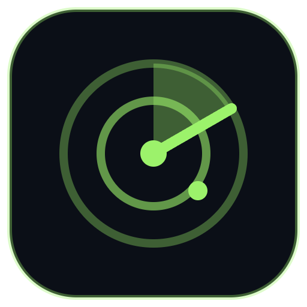
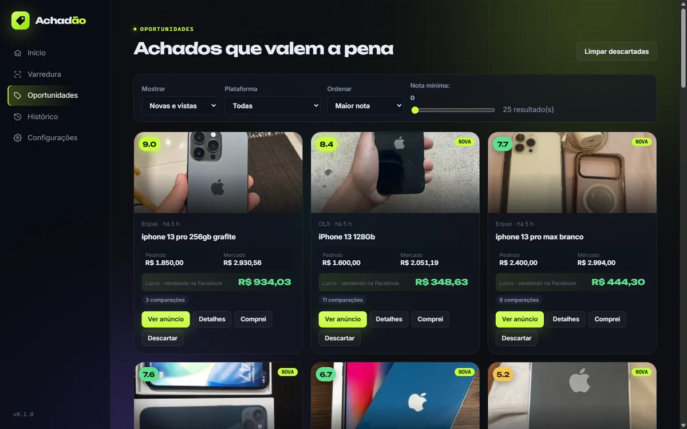
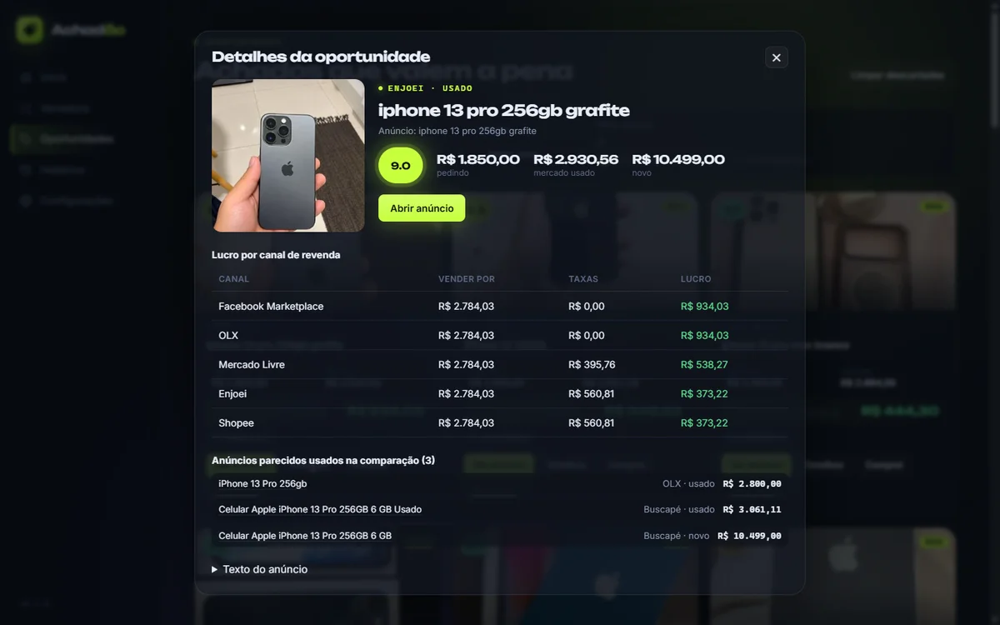
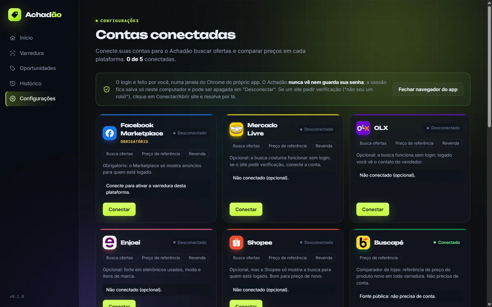
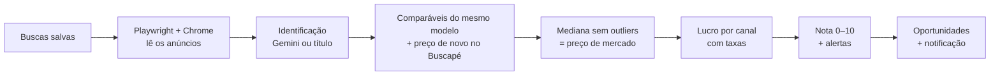

<div align="center">



# Achadão

### Seu achadão do dia.

Varre **Facebook Marketplace, OLX, Enjoei, Mercado Livre e Shopee**, compara com o preço de mercado<br/>
e te mostra só o que **dá lucro na revenda** — antes de todo mundo.

[](https://github.com/KevinLopes23/radar-revenda/releases/latest)

[](https://github.com/KevinLopes23/radar-revenda/releases/latest)
[](https://github.com/KevinLopes23/radar-revenda/releases)
[](LICENSE)


<br/>


<sub>🎬 <a href="docs/media/achadao-demo.mp4">Ver o vídeo completo em alta qualidade (MP4, 44 s)</a></sub>

</div>

---

## 💡 Por que existe

Quem compra para revender sabe: **o bom negócio some em minutos**. Ficar atualizando cinco sites o dia inteiro e fazendo
conta de cabeça não escala. O Achadão faz isso por você:

1. **Busca** os anúncios novos das suas buscas salvas em várias plataformas;
2. **Identifica** o produto exato (modelo, capacidade, estado) — com IA, se você quiser;
3. **Compara** com anúncios do mesmo modelo e com o preço de novo no Buscapé;
4. **Calcula** o lucro em cada canal de revenda já com as taxas, dá uma **nota de 0 a 10** e avisa sobre golpes.

> Foco em **eletrônicos** (celulares, consoles, notebooks, peças de PC), mas funciona bem em outras categorias de alta
> liquidez: ferramentas elétricas, foto/vídeo, instrumentos e eletroportáteis de marca.

## 📸 Telas

<table>
  <tr>
    <td width="50%"></td>
    <td width="50%"></td>
  </tr>
  <tr>
    <td align="center"><b>Início</b> — mosaico com as fotos dos achados e o resumo do dia</td>
    <td align="center"><b>Oportunidades</b> — nota, preço pedido, preço de mercado e lucro</td>
  </tr>
  <tr>
    <td width="50%"></td>
    <td width="50%"></td>
  </tr>
  <tr>
    <td align="center"><b>Detalhes</b> — lucro em cada canal e os anúncios usados na comparação</td>
    <td align="center"><b>Configurações</b> — conecte suas contas; a senha nunca passa pelo app</td>
  </tr>
</table>

## ✨ Funcionalidades

| | |
|---|---|
| 🔎 **Varredura automática** | Buscas salvas (termo, faixa de preço, plataformas) rodam sozinhas a cada X minutos, com ritmo "humano" e detecção de bloqueio. |
| 🤖 **Identificação com IA** | O Gemini lê título, descrição e fotos para achar o modelo exato, a capacidade e sinais de golpe. Sem chave, usa só o título. |
| 📊 **Preço de mercado de verdade** | Mediana dos anúncios **do mesmo modelo** (mesma capacidade e variante; cores ignoradas; acessórios e outliers fora). |
| 💰 **Lucro por canal** | Facebook, OLX, Mercado Livre, Enjoei e Shopee, com comissão, taxa fixa e frete configuráveis. |
| ⭐ **Nota de 0 a 10** | Margem + lucro absoluto + confiança na comparação − riscos. Os melhores aparecem primeiro. |
| ⚠️ **Alertas de risco** | Preço bom demais (golpe?), iCloud/bloqueio, "não liga", "para peças", réplica — e sinal verde quando o vendedor tem pressa. |
| 🔔 **Notificações do Windows** | Aparece um achado acima da nota que você escolher? O Windows te avisa. |
| 📒 **Histórico** | Registre o que comprou e vendeu e veja o lucro real, já descontando as taxas. |
| 🔐 **Privacidade** | Tudo fica no seu PC. O login é feito por você no site; a chave do Gemini é criptografada pelo Windows. |

## ⬇️ Instalação

1. Baixe o **`Achadao-Setup-<versão>.exe`** na [página de Releases](https://github.com/KevinLopes23/radar-revenda/releases/latest) e execute.
2. O Windows pode mostrar *"O Windows protegeu o computador"* — o instalador ainda não tem assinatura digital paga.
   Clique em **Mais informações → Executar assim mesmo**.
3. Requisitos: **Windows 10/11 64 bits** e **Google Chrome** instalado (o app usa o Chrome para ler os sites).
4. Recomendado: uma chave **gratuita** do Gemini em [aistudio.google.com/apikey](https://aistudio.google.com/apikey).

## 📖 Como usar

1. **Configurações** → conecte o Facebook (obrigatório para o Marketplace) e, se quiser, as outras contas.
   Cole a chave do Gemini e confira as taxas de cada canal.
2. **Varredura** → **+ Nova busca** (ex.: `iphone 13`, de R$ 800 a R$ 2.000) → **Rodar agora**.
   Ligue a varredura automática em Configurações para rodar sozinho.
3. **Oportunidades** → cards ordenados pela nota. **Detalhes** mostra o lucro por canal, os anúncios comparados e
   os alertas. **Comprei** manda para o Histórico.
4. **Histórico** → quando vender, clique em **Vendi** para registrar o lucro real.

## ⚙️ Como funciona



- **Preço de mercado** = mediana dos usados do mesmo modelo, com a **faixa típica** (metade dos anúncios custa entre o 1º e o 3º quartil); sem usados para comparar, usa 70% do preço de novo do Buscapé. Preços de "novo" acima de 2,5× o usado são descartados (quase sempre é outro produto).
- **Lucro por canal** = preço de mercado − desconto para vender rápido (padrão 12%, porque anúncio mostra preço pedido, não preço vendido) − comissão − taxa fixa − frete − preço pedido − custo extra.
- **Pior caso** = o mesmo cálculo com o preço baixo da faixa. Se aí não sobra lucro, o app avisa para negociar antes de comprar.
- **Liquidez** = quantos usados iguais estão à venda (8+ alta, 4–7 média, menos de 4 baixa = "revenda lenta").
- **Nota** = margem (até 6) + lucro absoluto (até 2) + confiança na comparação (até 2) − liquidez baixa (1) − riscos.

Detalhes técnicos em [`docs/ARQUITETURA.md`](docs/ARQUITETURA.md).

## 🔌 Plataformas

| Plataforma | Busca ofertas | Preço de referência | Revenda | Conta |
|---|:-:|:-:|:-:|---|
| Facebook Marketplace | ✅ | ✅ | ✅ | Obrigatória (login detectado automaticamente) |
| Mercado Livre | ✅ | ✅ | ✅ | Opcional |
| OLX | ✅ | ✅ | ✅ | Opcional |
| Enjoei | ✅ | ✅ | ✅ | Opcional |
| Shopee | ✅ | ✅ | ✅ | Opcional (a busca costuma pedir login) |
| Buscapé | — | ✅ | — | Não precisa |

## 🧱 Stack

| Camada | Tecnologia |
|---|---|
| App desktop | Electron + React 19 + TypeScript (electron-vite), animações em CSS, fontes Unbounded + Inter embutidas |
| Automação | Playwright (`playwright-core`) com o Google Chrome instalado e perfil próprio do app |
| IA | Google Gemini API (`@google/genai`), modelo configurável (padrão `gemini-flash-latest`) |
| Dados locais | Arquivos JSON validados com zod, gravação atômica |
| Qualidade | Vitest (179 testes), `tsc --noEmit`, CSP restrita, IPC validado |
| Instalador | electron-builder (NSIS `.exe`) |

## 🛠️ Desenvolvimento

Requisitos: Node 20+ e Google Chrome instalado.

```bash
npm install
npm run dev        # abre o app em modo desenvolvimento
npm test           # testes unitários (Vitest)
npm run typecheck  # checagem de tipos
npm run build      # build de produção em out/
npm run dist       # gera o instalador em release/Achadao-Setup-<versão>.exe
```

Os dados locais (perfil do navegador com as sessões, buscas, oportunidades, histórico e a chave do Gemini
criptografada pelo Windows) ficam em `%APPDATA%\radar-revenda` (modo dev) ou `%APPDATA%\Achadão`
(app instalado) — nunca no repositório.

## 🧪 Limitações conhecidas

- Sites mudam o layout com frequência; a leitura é genérica (links de anúncio + preço), mas pode precisar de ajuste.
- Mercado Livre, OLX e Shopee às vezes pedem login ou verificação anti-robô. O app avisa no log da varredura;
  basta abrir a plataforma em Configurações e resolver a verificação uma vez.
- Sem chave do Gemini, a identificação do produto é feita só pelo título (menos precisa).

## 🗺️ Roadmap

- [x] App base + contas conectadas
- [x] Varredura com ritmo humano e detecção de bloqueio
- [x] IA (Gemini) + pesquisa de preços + lucro por canal
- [x] Oportunidades, nota, alertas e notificações
- [x] Histórico de compras e vendas + instalador `.exe`
- [ ] Mais fontes de preço de referência (Amazon, Trocafone)
- [ ] Atualização automática do app
- [ ] Instalador com assinatura digital

Ideias e bugs: abra uma [issue](https://github.com/KevinLopes23/radar-revenda/issues). 💚

## ⚠️ Aviso

O Facebook Marketplace não possui API pública e a automação pode violar os Termos de Uso da Meta.
O app usa limites conservadores (intervalos aleatórios, poucos anúncios por rodada, pausa em verificações),
mas **o risco de restrição da conta não é zero**. Use por sua conta e risco; o app é fornecido "como está", sem garantias.

## 📄 Licença

[MIT](LICENSE) © 2026 Kevin Lopes.
Projeto independente, sem vínculo com Meta, OLX, Mercado Livre, Enjoei, Shopee ou Buscapé — os nomes e logos
pertencem aos respectivos donos e aparecem só para identificar as plataformas.
